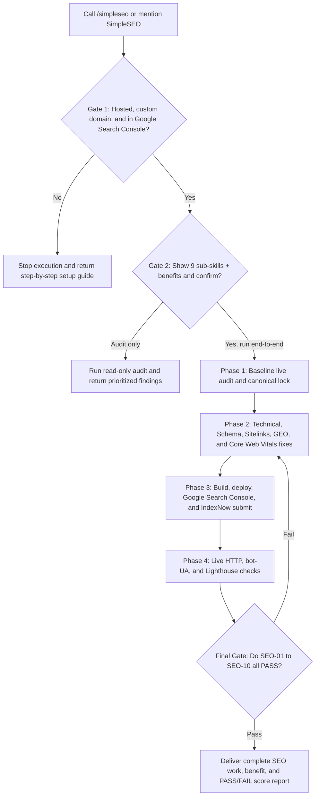

<div align="center">
  <picture>
    <source media="(prefers-color-scheme: dark)" srcset=".github/simpleseo-wordmark-dark.png" />
    <source media="(prefers-color-scheme: light)" srcset=".github/simpleseo-wordmark-light.png" />
    
  </picture>

  <h1>SimpleSEO: One Skill Call from Deployed URL to Google-Ranked &amp; AI-Cited</h1>
</div>

---

<p align="center">
  <code>npx skills add 0xMinomus/SimpleSEO</code>
</p>

<p align="center">
  <a href="#prerequisites">Prerequisites</a>
  ·
  <a href="#how-simpleseo-works">How it works</a>
  ·
  <a href="#included-sub-skills--benefits">Sub-skills</a>
  ·
  <a href="#final-pass-gate--delivery-report">PASS Gate</a>
  ·
  <a href="#installation">Install</a>
  ·
  <a href="#standalone-cli-tools">CLI tools</a>
</p>

<p align="center">
  <a href="https://github.com/0xMinomus/SimpleSEO/releases/tag/v1.0"></a>
  
  
  <a href="LICENSE"></a>
  
</p>

---

## Table of contents

- [About](#about)
- [Prerequisites](#prerequisites)
- [How SimpleSEO works](#how-simpleseo-works)
- [Included sub-skills & benefits](#included-sub-skills--benefits)
- [Final PASS gate & delivery report](#final-pass-gate--delivery-report)
- [Supported coding agents](#supported-coding-agents)
- [Installation](#installation)
- [Usage](#usage)
- [Standalone CLI tools](#standalone-cli-tools)
- [Running tests](#running-tests)
- [Project structure](#project-structure)
- [Honest scope note](#honest-scope-note)
- [Contributing](#contributing)
- [Code of Conduct](#code-of-conduct)
- [Security](#security)
- [License](#license)

## About

Most SEO tools stop at dumping a list of warnings that you still have to fix manually. **SimpleSEO** is a single, universal SEO skill pack built for **any AI coding agent** (Oh My Pi, OpenAI Codex, Claude Code, Cursor, Gemini CLI, OpenCode, Cline, Kimi Code, Windsurf, and GitHub Copilot).

Call `/simpleseo` once, confirm two quick checkpoints, and let your agent audit your live site, repair technical bottlenecks in code, build Sitelinks and Schema.org architecture, open access for AI answer engines, submit sitemaps to Google Search Console and IndexNow, verify everything against live Lighthouse/PageSpeed scores, and hand you a complete `PASS/FAIL` report.

## Prerequisites

SimpleSEO only requires three things before you run it:

1. **Hosted and live over HTTPS** (Vercel, Cloudflare Pages, Netlify, VPS, etc.).
2. **A custom domain connected** (`yourdomain.com` or `www.yourdomain.com`).
3. **Registered in Google Search Console** (Domain property or URL-prefix property).

If any requirement is not ready yet, choose **No** at Gate 1. SimpleSEO stops immediately and gives you a step-by-step setup guide for deployment, DNS, and Google Search Console verification.

## How SimpleSEO works

SimpleSEO never touches your codebase or Search Console account without permission. Every run follows a strict four-stage loop:



## Included sub-skills & benefits

All 9 sub-skills live inside one package so you never have to chain separate plugins:

| # | Sub-Skill | What It Handles | Benefit to Your Website |
|---|---|---|---|
| 1 | **Technical & Crawl Architecture** | Aligns canonicals across config/HTML/sitemap/JSON-LD, redirects `/sitemap.xml` to `/sitemap-index.xml`, enforces RFC 9309 `robots.txt`, adds security & immutable cache headers, and ships a `noindex` `404` page. | Crawlers index the exact canonical host with zero redirect loops, 404 traps, or wasted crawl budget. |
| 2 | **Structured Data & Schema.org** | Emits server-rendered JSON-LD `@graph` (`ProfessionalService` / `LocalBusiness` / `Organization`, `WebSite`, `WebPage`, `BreadcrumbList`, `SiteNavigationElement`, `OfferCatalog`, `Product`, `FAQPage`) with zero deprecated types. | Qualifies your pages for rich results, accurate entity recognition, and clean pricing/service parsing. |
| 3 | **On-Page, Sitelinks & Social Cards** | Optimizes titles and meta descriptions, adds `hreflang`, creates intent-driven sub-pages linked cleanly from footer/nav, and updates `1200x630` Open Graph & Twitter share cards. | Higher search CTR, multi-link Google Sitelinks under your brand, and clean social previews. |
| 4 | **AI Search & Agent Readiness (GEO)** | Allows explicit crawl access for `OAI-SearchBot`, `ChatGPT-User`, `Claude-SearchBot`, `PerplexityBot`, and `Google-Extended`; creates `llms.txt` and `/.well-known/ai-catalog.json` (ARD v1.0); structures direct answer blocks. | Makes your brand crawlable, understood, and cited by ChatGPT Search, Perplexity, Claude, and Google AI Overviews. |
| 5 | **Core Web Vitals & Image SEO** | Adds LCP `<link rel="preload">` + `fetchpriority="high"`, explicit `width` and `height` on every ``, lazy loading below the fold, and proper `alt` / `role="presentation"` markup. | Locks `CLS = 0`, boosts mobile speed, and targets 100/100 Accessibility. |
| 6 | **Search Engine Submission (GSC + IndexNow)** | Verifies GSC Domain property via DNS `TXT`, cleans stale CMS sitemaps, submits live `sitemap-index.xml`, runs Live URL Test + Request Indexing, and pings `api.indexnow.org`. | Accelerates indexing across both Google and Bing/Copilot/ChatGPT Search from weeks to hours. |
| 7 | **Local SEO, E-E-A-T & Off-Page Plan** | Adds `geo.region`, `geo.placename`, and `areaServed`, checks real trust/contact signals without fake claims, and maps out Google Business Profile, backlinks, and brand mentions. | Improves local map pack visibility and teaches AI models to recommend your exact brand. |
| 8 | **Content Quality & Topic Clusters** | Audits thin routes, heading order (`H1` to `H3`), duplicate metadata, and internal cross-linking across services. | Prevents keyword cannibalization and builds topical depth. |
| 9 | **Live Verification & Final PASS Gate** | Runs live HTTP/bot-UA checks, validates `llms.txt` and `ai-catalog.json`, checks PageSpeed Insights / Lighthouse scores, and enforces the 10-point `PASS/FAIL` gate before reporting. | Guarantees every change works in live production and summarizes exact outcomes for you. |

## Final PASS gate & delivery report

At the end of execution, SimpleSEO runs a mandatory **10-point PASS Gate (`SEO-01` through `SEO-10`)** checking canonicals, sitemaps, RFC 9309 `robots.txt`, JSON-LD validity, Sitelinks/OG cards, `llms.txt` + ARD `ai-catalog.json`, `width`/`height` + `CLS = 0`, GSC + IndexNow status, live Lighthouse scores, and security/copy hygiene.

If any item fails, the agent fixes and re-verifies it first. Once green, it hands you a complete final report covering:
- Every SEO file and submission completed
- The exact benefit each change gives your website
- Whether every check passed (`PASS`) or still needs an external off-page action (such as registering Google Business Profile)

## Supported coding agents

SimpleSEO ships universal entrypoints (`SKILL.md`, `AGENTS.md`, `CLAUDE.md`, `.gemini/GEMINI.md`, `.github/copilot-instructions.md`) and plugin manifests (`.claude-plugin`, `.codex-plugin`, `.cursor-plugin`, `.omp-plugin`, `.kimi-plugin`, `.cline-plugin`) so it works natively across:

- **Oh My Pi (`omp`)**
- **OpenAI Codex**
- **Claude Code**
- **Cursor**
- **Gemini CLI**
- **OpenCode**
- **Kimi Code**
- **Cline**
- **Windsurf & GitHub Copilot**

## Installation

### Option 1: Universal Skills CLI (`npx skills`)

```bash
npx skills add 0xMinomus/SimpleSEO
```

### Option 2: Clone Directly for Your Agent

```bash
# Oh My Pi
git clone https://github.com/0xMinomus/SimpleSEO.git ~/.omp/agent/skills/SimpleSEO

# Claude Code
git clone https://github.com/0xMinomus/SimpleSEO.git ~/.claude/skills/SimpleSEO

# OpenAI Codex
git clone https://github.com/0xMinomus/SimpleSEO.git ~/.codex/skills/SimpleSEO

# Cursor
git clone https://github.com/0xMinomus/SimpleSEO.git ~/.cursor/skills/SimpleSEO

# Gemini CLI
git clone https://github.com/0xMinomus/SimpleSEO.git ~/.gemini/skills/SimpleSEO
```

### Option 3: Inside a Project Workspace

Clone `SimpleSEO` into your workspace and tell your agent to read `SKILL.md` or `AGENTS.md`.

## Usage

1. Open your website project in your preferred AI coding agent.
2. Call the skill explicitly or by name:
   ```text
   /simpleseo https://www.yourdomain.com
   ```
   ```text
   Run SimpleSEO on this repository and https://www.yourdomain.com
   ```
3. Answer **Gate 1** (prerequisites check) and **Gate 2** (execution confirmation).
4. Review the final **PASS Gate** audit matrix and complete SEO summary report.

## Standalone CLI tools

All bundled Python scripts run on **Python 3.10+ standard library only** (zero `pip install` required):

### 1. Live Site & AI Readiness Auditor

```bash
python3 scripts/simpleseo_audit.py https://www.yourdomain.com --format markdown
python3 scripts/simpleseo_audit.py https://www.yourdomain.com --format json
```

### 2. Asset Generator (`robots.txt`, `llms.txt`, `ai-catalog.json`)

```bash
python3 scripts/generate_assets.py \
  --brand "YourBrand" \
  --domain "yourdomain.com" \
  --origin "https://www.yourdomain.com" \
  --summary "Clear one-paragraph overview of your business and services." \
  --public-dir ./public
```

### 3. IndexNow Key Creator & Instant Ping

```bash
python3 scripts/indexnow_ping.py \
  --host www.yourdomain.com \
  --public-dir ./public \
  --urls https://www.yourdomain.com/ https://www.yourdomain.com/services/
```

## Running tests

```bash
python3 -m unittest discover -s tests -v
```

## Project structure

```text
SimpleSEO/
├── SKILL.md                        # Universal orchestrator, 2-gate onboarding & final PASS gate
├── AGENTS.md                       # Universal entrypoint for Codex, omp, OpenCode, and Cline
├── CLAUDE.md                       # Claude Code pointer
├── .github/                        # Copilot instructions & theme-aware README wordmarks
├── .claude-plugin/                 # Claude Code plugin & marketplace manifests
├── .codex-plugin/                  # OpenAI Codex plugin manifest
├── .cursor-plugin/                 # Cursor plugin manifest
├── .omp-plugin/                    # Oh My Pi marketplace manifest
├── .kimi-plugin/                   # Kimi Code plugin manifest
├── .cline-plugin/                  # Cline plugin manifest
├── .gemini/                        # Gemini CLI instructions
├── subskills/                      # 9 modular execution guides
├── references/                     # Setup guide, Schema templates, ARD & QA checklists
├── scripts/                        # Zero-dependency Python 3 audit, generator, and IndexNow CLIs
├── tests/                          # Automated unit tests
├── LICENSE                         # MIT License
├── SECURITY.md                     # Security policy
├── CODE_OF_CONDUCT.md              # Contributor Covenant v2.1
├── CONTRIBUTING.md                 # Contribution guidelines
└── CHANGELOG.md                    # Release notes
```

## Honest scope note

SimpleSEO automates and verifies everything inside your website code, hosting headers, structured data, performance, Google Search Console, and IndexNow. Off-page authority factors such as Google Business Profile registration, genuine customer reviews, and third-party backlinks or brand mentions happen outside your repository, and SimpleSEO prints that exact action list clearly instead of fabricating fake metrics.

## Contributing

Contributions are welcome. See [CONTRIBUTING.md](CONTRIBUTING.md) before opening a pull request.

## Code of Conduct

This project follows the Contributor Covenant. See [CODE_OF_CONDUCT.md](CODE_OF_CONDUCT.md).

## Security

To report a security issue privately, see [SECURITY.md](SECURITY.md).

## License

Released under the [MIT License](LICENSE). Built by [Andika Putra (0xMinomus)](https://github.com/0xMinomus).
